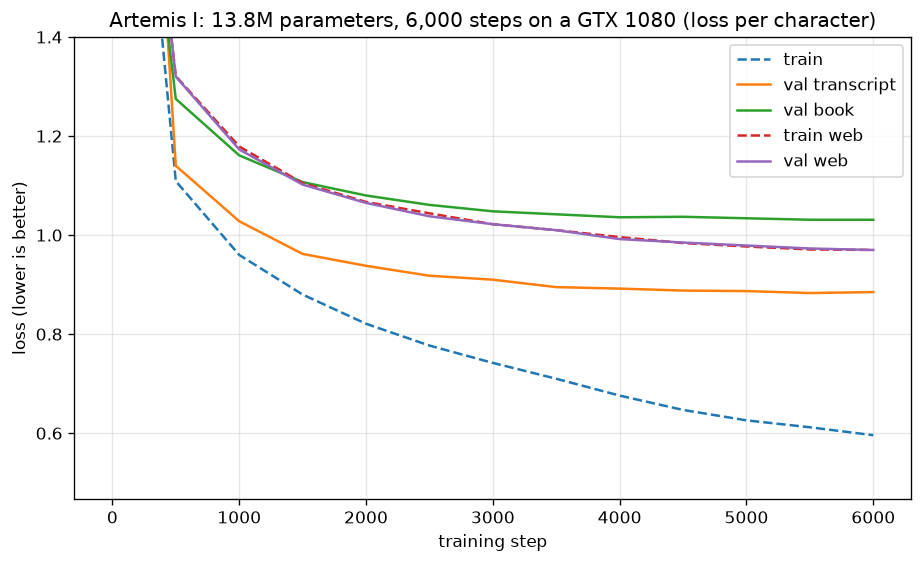

# Writeup 1 · Artemis I: a GPT from an empty file

Artemis I is a 13.8M-parameter language model, written from scratch and trained on NASA
text plus general English on a single 2016-era GPU (a GTX 1080). It is the uncrewed test
flight of this project: it exists to prove the training stack end to end, and to learn
how every piece of a GPT works by building it.

Every number below comes from a run recorded in the [Flight Log](../FLIGHT_LOG.md), which
has one entry per step, with its measurements. "Step N" means Phase 1, Stage 4, Step N;
earlier entries are named by their title.

## The result

| | |
|---|---|
| Parameters | 13,767,552 (6 blocks, 384 channels, 6 heads of 64) |
| Vocabulary | 4,096 byte-level BPE tokens, learned from NASA + web text |
| Context | 256 tokens (~890 characters) |
| Training data | 25% NASA (Apollo 11 transcript, 4 NASA history books), 75% FineWeb-Edu |
| Training | 6,000 steps of 16,384 tokens (~98M tokens), Muon + AdamW, fp32 |
| Time | 67 minutes on a GTX 1080 |
| Score | **1.367 bits per byte** on 860 held-out FineWeb-Edu documents |

Bits per byte measures how surprised the model is by text it has never seen, per byte of
that text: lower is better. Unlike per-token loss, it doesn't depend on the tokenizer, so
any two models can be compared on it (`pretrain/score_bpb.py`, Step 19).

The run is reproducible: retraining with the same seed gave the same numbers at every
report, to three decimals (Step 33). Another seed scored 1.360, so differences under about
0.007 are luck (Step 32).



Dashed lines are text the model trains on; solid lines are held-out text. On web text the
two coincide: the run read ~74M of 94M web tokens, less than one pass, so there was
nothing to memorize. On NASA text they split apart: the 1.1M NASA tokens were read ~23
times, and while NASA training loss kept falling, NASA validation flattened from about
step 4,000. That gap is memorization, and it is why training stops at 6,000 steps
(Step 34).

What it writes, unprompted (the end of the final run's sample):

```
00 02 09 00 CC
Apollo 11, this is Houston. Mighty fine. Go ahead.

00 02 09 10 LMP
Roger. You sure should have no crew status report for us. Any better information when you come up with high gain in HA is NA.

00 02 11 21 CC
Roger. Stand by.

00 02 11 45 CC
Apollo 11, this is Houston. AOS at Goldstone. Over.
```

It has learned the surface of the transcript: timestamps that count upward, speaker
codes, call signs, and real jargon (AOS at Goldstone, TEI, P00). It has not learned
meaning: the lines sound right and say nothing. That is roughly what to expect from a
model this size and this little NASA text.

## How it was built

Phase 1 ran in four stages, each in small steps, each step measured before the next.

**Stage 1: a GPT from an empty file.** Starting from a character-level bigram model on the
Apollo 11 transcript, each piece of a transformer was added and measured on its own:
attention, multiple heads, the MLP, residual connections, normalization, stacked blocks.
Validation loss per character went from 2.464 (bigram, "Training loop") to 1.661 (four
blocks, "Stacked transformer blocks"). Two results stood out. Removing residuals and norms from the stacked model left
it stuck at 3.125, worse than the bigram: depth is only useful when it is trainable. And a
model that can't drive the loss on a single batch to near zero is broken, whatever the
data ("Overfit one batch").

**Stage 2: modern upgrades.** RMSNorm, rotary position embeddings (RoPE), all heads in one
batched computation, a SwiGLU MLP, and no biases. Batching the heads cut a training step
from 70.5 to 27.4 ms ("Batched attention heads"). The quality upgrades all landed at about the same score
(~1.27): the model had run out of data, not ideas. With one 826,031-character transcript,
it was reading each character ~55 times ("Scale up", "SwiGLU").

**Stage 3: a tokenizer.** Byte-level BPE, written by hand: start from bytes, repeatedly
merge the most frequent neighbouring pair. Counting pairs alone discovers words: "Houston"
became one token by itself. Training on 1,024 tokens instead of characters improved val
loss per character from 1.270 / 1.347 to 1.184 / 1.279 (transcript / book), although three
things changed at once ("BPE vs characters").

**Stage 4: a real training run.** Learning-rate warmup and cosine decay, gradient
clipping, cleaned books, general English text, an 11M-parameter model, a bigger
vocabulary, and finally nanochat's training ideas, one at a time. The table follows the
score that settled each choice, on the same held-out web text:

| Recipe | Bits per byte | Step |
|---|---|---|
| vocabulary 1,024, 64-token context | 1.613 | 19 |
| vocabulary 4,096 | 1.522 | 19 |
| 256-token context, 6,000 steps | 1.423 | 20 |
| + Muon optimizer for the weight matrices | 1.387 | 23 |
| + QK norm in attention | 1.372 | 26 |
| + ReLU² MLP (instead of SwiGLU) = **Artemis I** | **1.367** | 28, 33 |
| nanochat's small recipe, trained on the same data | 1.199 | 19 |

## What we learned

**Data runs out before ideas do.** The limit moved back and forth between model and data
all through Phase 1. A 0.8M-parameter model memorized one transcript ("Scale up"); four NASA
books fixed that ("Train on transcript + books"); a bigger model then memorized those
(Step 10). Today the limit is NASA text again: a bigger vocabulary helped web text but
memorized NASA sooner, a tie where it counts (Step 25).

**The mixture matters more than the amount.** Adding 327M characters of web text by plain
concatenation gave NASA 1.1% of training and made NASA text *worse*. Giving NASA a fixed
share of every batch made both NASA validation sets better than NASA-only training
(Step 9). The share was then fitted to the model: 25% for the 11M model (Step 11).

**Small details of the tokenizer can matter a lot.** After cleaning the books, the
transcript got worse (1.174 to 1.252). The cause: removing number-heavy pages left the
tokenizer cutting numbers inconsistently ("29" as "2"+"9" but "03" whole). Splitting every
number into single digits, as Llama does, fixed the timestamps: transcript headers went
from 1.972 to 0.965 (Steps 6-7).

**Compare models only on a shared, exact measure.** Per-token losses from different
tokenizers can't be compared, and random-window losses differ from whole-text scores.
Grading every model with one scorer showed that most of the early gap to nanochat was
context: limited to the 47 tokens covering what our 64 did, nanochat scored worse than
our model (1.577 vs 1.522) (Step 19).

**Measure the noise.** For several steps, small differences were called "noise-sized"
without a number behind it. A rerun with only the seed changed showed 0.007 bits per byte
of pure luck. Measured against that, Muon (0.036) and QK norm (0.015) are real, ReLU² is
real on NASA book text (0.012 vs 0.005 seed gap) though not on web text, and
zero-initialized projections and logit softcap (0.001-0.002) are not, so they stayed off
(Step 32).

## Compared with nanochat

[nanochat](https://github.com/karpathy/nanochat) is a reference implementation of the same
kind of model. Its small recipe has the same core (6 layers, 384 channels, 6 heads of 64)
and scores 1.199 on our web text, versus our 1.367. The race isn't equal, and the plan's
goal of matching its curve was only partly met:

- nanochat has 73.5M parameters, mostly in its 32,768-token vocabulary tables (ours: 4,096).
- It trained on web text only; Artemis I spends a quarter of its steps on NASA text.
- It reads 512 tokens of context; at our size, going from 256 to 512 gained only 0.011
  (Step 21).

Instead of swapping our model into nanochat, we brought its ideas into our model one at a
time. That closed 0.056 of the gap (1.423 to 1.367) and showed which ideas didn't help
here.

## Limits

- Only ~4.3M characters of NASA text, from five documents. This is the binding limit.
- English only, ASCII only: the book cleaning dropped symbols such as "Δ" and "₂".
- One validation book and one stretch of transcript stand in for "NASA text in general".
- No instruction following or chat: Artemis I only continues text.
- Single runs for most comparisons; the noise estimate comes from two seeds.

## Next: Phase 2

Phase 2 builds the NASA corpus this run was missing: a harvester for the NASA Technical
Reports Server with a license decision per document, PDF extraction, cleaning and
deduplication. Phase 2 also writes FLIGHT-Bench, the hand-verified benchmark that Artemis II
will be measured on.

## Reproduce it

```bash
python -m pretrain.prepare_apollo11       # Apollo 11 transcript
python -m data.prepare_nasa_books         # four NASA history books (license-checked)
python -m data.prepare_fineweb_edu        # one FineWeb-Edu file, split by document
python -m pretrain.train_tokenizer        # 4,096-token tokenizer (Python: ~28 min)
python -m pretrain.train --checkpoint checkpoints/artemis_i.pt
python -m pretrain.score_bpb --checkpoint checkpoints/artemis_i.pt
python -m pretrain.sample --checkpoint checkpoints/artemis_i.pt --prompt "Houston, "
```
